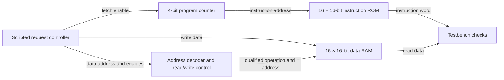

# Harvard memory subsystem

The controller and Harvard top are connected in the testbench. The PC, ROM and data path are inside the top. The testbench also observes both valid signals. Both paths share the clock. A legal data request can complete on the same rising edge as an instruction fetch because each path has its own address and memory. The instruction word and read data are visible before the edge. At the edge, a fetch advances the PC and a write updates RAM.

The shared-memory baseline maps instruction and data addresses into two regions of one array and selects one address per cycle. When legal data and fetch requests overlap, the baseline grants data. The requester holds the fetch for the next available cycle. See the [interface contract](interfaces.md) for stimulus, timing and measurement rules.
