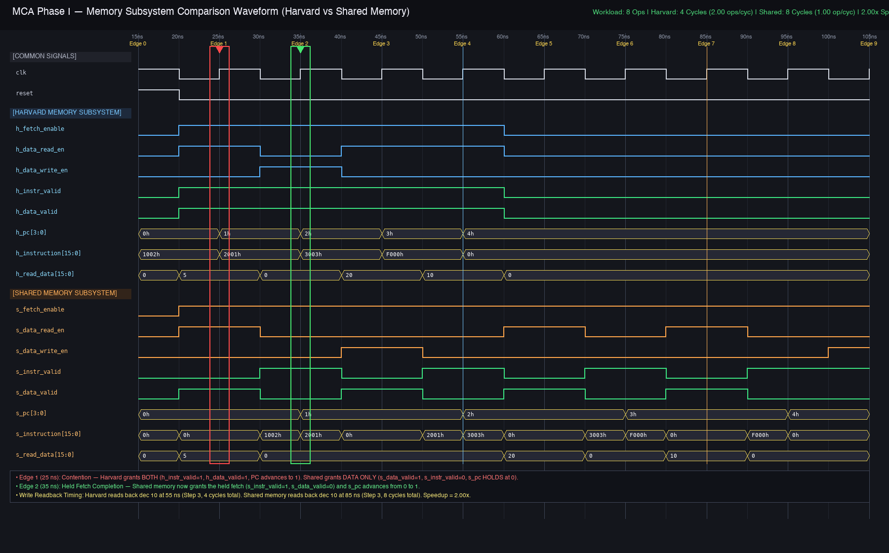

# Subsystem Performance Comparison: Harvard vs. Single-Port Shared Memory

## 1. Overview and Architecture Comparison

This report evaluates and compares the memory-access throughput and execution behavior of two memory subsystem architectures under an identical benchmark workload:
1. **Harvard Subsystem (`harvard_top`):** Employs isolated instruction ROM (16×16) and data RAM (16×16) address spaces, buses, and ports. This permits simultaneous instruction fetching and data read/write operations on the exact same clock cycle without structural hazards.
2. **Shared-Memory Baseline (`shared_memory`):** Implements a unified 32×16 memory array with a single physical read port and single write port. Physical words `0–15` map to instruction storage, while words `16–31` map to data storage. A central arbiter prioritizes legal data transactions over instruction fetches. When a data access is granted, the program counter holds and the instruction fetch remains pending until the next available cycle.

---

## 2. Benchmark Workload

Both designs are subjected to the standardized 4-pair request sequence from the Phase I interface specification:

| Step / Row | Fetch PC | ROM Instruction | Data Operation | Data Address | Write Data | Expected Read Data |
| :---: | :---: | :---: | :---: | :---: | :---: | :---: |
| **0** | `0` | `16'h1002` | Read Word 2 | `5'd2` | — | `5` |
| **1** | `1` | `16'h2001` | Write Word 3 | `5'd3` | `16'd10` | `0` (write) |
| **2** | `2` | `16'h3003` | Read Word 1 | `5'd1` | — | `20` |
| **3** | `3` | `16'hF000` | Readback Word 3 | `5'd3` | — | `10` |

---

## 3. Measured Cycle Counts and Memory-Access Throughput

The testbench (`testbench/tb_comparison.v`) drives both devices under test (DUTs) independently with separate row counters and request pending flags. Cycles are counted strictly from the first active request rising edge to the final grant edge, excluding reset and test initialization.

### Verified Simulation Results (`make -B test-comparison`)

```text
mkdir -p build
iverilog -g2005 -Wall -s tb_comparison -o build/tb_comparison rtl/program_counter.v rtl/instruction_memory.v rtl/data_path.v rtl/address_decoder.v rtl/read_write_control.v rtl/data_memory.v rtl/harvard_top.v rtl/shared_memory.v testbench/tb_comparison.v
vvp build/tb_comparison
VCD info: dumpfile build/comparison.vcd opened for output.
------------------------------------------------------------
Workload Complete
Harvard DUT:       Cycles = 4, Grants = 8, Ops/Cycle = 2.00
Shared-Memory DUT: Cycles = 8, Grants = 8, Ops/Cycle = 1.00
Speedup Ratio:     2.00x
------------------------------------------------------------
PASS: All comparison checks and corner-case tests passed successfully!
```

### Quantitative Metrics for the Four-Pair Workload

| Metric | Harvard Subsystem | Shared-Memory Baseline | Architectural Advantage |
| :--- | :---: | :---: | :---: |
| **Total Accepted Operations** | 8 (4 fetch + 4 data) | 8 (4 fetch + 4 data) | Identical Workload |
| **Elapsed Execution Cycles** | **4 cycles** | **8 cycles** | 50% fewer cycles |
| **Memory-Access Throughput** | **2.00 ops/cycle** | **1.00 op/cycle** | **2.00× higher throughput** |
| **Throughput Speedup Ratio** | **2.00×** | **1.00×** | **2.00× speedup** |
| **Arbitration Stalls** | 0 stalls | 4 stalls (1 stall per pair) | Zero structural hazard |

---

## 4. Waveform Inspection and Clock Edge Analysis

The verified comparison waveform is committed at [docs/comparison-waveform.png](comparison-waveform.png).



### Key Clock Edges Identified in the Waveform:

1. **Edge 1 ($t = 25\,\text{ns}$ — Contested Request Rising Edge):**
   - **Harvard Subsystem:** Both `h_instruction_valid = 1` and `h_data_valid = 1` are settled high before the rising edge. Instruction `1002h` is fetched combinationally while RAM word 2 returns decimal `5`. At the $25\,\text{ns}$ rising edge, both transactions commit, and `h_pc` advances from `0` to `1`.
   - **Shared-Memory Baseline:** Structural contention occurs at the single shared port. The arbiter gives strict priority to the legal data read:
     - Just before the rising edge: `s_data_valid = 1` (returning decimal `5`), and `s_instruction_valid = 0` (fetch suppressed).
     - At the $25\,\text{ns}$ rising edge: Data read commits, while the pending fetch remains held. Consequently, `s_pc` strictly **holds at 0** across the clock edge.

2. **Edge 2 ($t = 35\,\text{ns}$ — Held Fetch Completion Rising Edge):**
   - **Shared-Memory Baseline:** Having completed the data operation on the preceding cycle, `s_data_read_enable` is deasserted. The single shared port is now allocated to the pending instruction fetch:
     - Just before the rising edge: `s_instruction_valid = 1` (returning instruction `1002h`), and `s_data_valid = 0`.
     - At the $35\,\text{ns}$ rising edge: The pending fetch commits, and `s_pc` successfully **advances from 0 to 1**.
   - This exact 2-cycle cadence repeats across all 4 request pairs, resulting in exactly $4 \times 2 = 8$ cycles for the baseline vs. 4 cycles for the Harvard subsystem.

3. **Write Readback Timing:**
   - In Step 1, a write of decimal `10` is committed to data word 3.
   - **Harvard Subsystem:** Reads back decimal `10` at **$t = 55\,\text{ns}$** (during Step 3, Cycle 4) while simultaneously fetching instruction `F000h` at PC `3`.
   - **Shared-Memory Baseline:** Reads back decimal `10` at **$t = 85\,\text{ns}$** (during Step 3, Cycle 7) while the fetch of `F000h` is held, completing the final held fetch on the subsequent cycle at **$t = 95\,\text{ns}$** (Cycle 8).

---

## 5. Verification of Arbitration & Robustness

Following the measured benchmark run, `tb_comparison.v` validates two critical corner cases to ensure invalid operations cannot degrade throughput or corrupt memory:
1. **Invalid Data Address (e.g., Address 17, bit 4 asserted):**
   - The decoder flags address 17 as out-of-range (`s_data_valid = 0`).
   - The arbiter ensures the invalid data request **does not consume the shared memory slot**, allowing the concurrent instruction fetch to proceed unimpeded (`s_instruction_valid = 1`).
2. **Conflicting Data Controls (Concurrent Read and Write asserts):**
   - Concurrent assertion of `read_enable` and `write_enable` suppresses data access (`s_data_valid = 0`).
   - Instruction fetch proceeds without stalling.
   - Subsequent readback verifies previously stored memory contents remain unaffected.

---

## 6. How to Reproduce Locally

To re-run the simulation and regenerate the waveform:
```sh
# 1. Compile and execute comparison testbench
make -B test-comparison

# 2. Open generated VCD in Surfer or GTKWave
surfer build/comparison.vcd
# or
gtkwave build/comparison.vcd
```

### Manual Capture Steps in GTKWave / Surfer:
1. Open `build/comparison.vcd` in your waveform viewer.
2. In the signal hierarchy under `tb_comparison`, add:
   - `clk`, `reset`
   - Harvard group: `h_fetch_enable`, `h_data_read_enable`, `h_data_write_enable`, `h_instruction_valid`, `h_data_valid`, `h_pc[3:0]`, `h_instruction[15:0]`, `h_read_data[15:0]`
   - Shared group: `s_fetch_enable`, `s_data_read_enable`, `s_data_write_enable`, `s_instruction_valid`, `s_data_valid`, `s_pc[3:0]`, `s_instruction[15:0]`, `s_read_data[15:0]`
3. Zoom to the time interval $15\,\text{ns}$ to $105\,\text{ns}$.
4. Ensure values are displayed in Hex for instructions/PC and Decimal for read data.
5. Highlight the rising edges at $25\,\text{ns}$ (contention) and $35\,\text{ns}$ (held fetch completion).
6. Capture the screen and save to `docs/comparison-waveform.png`.
