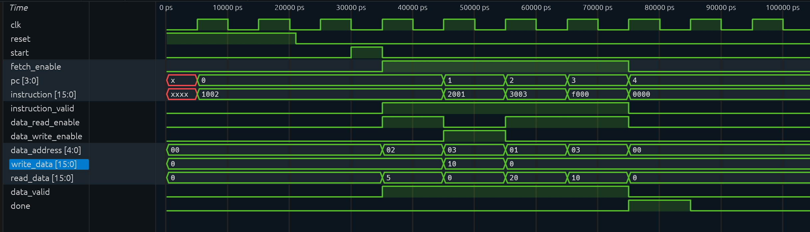

# Controller Design and Harvard Integration Test

**Member 3 — Controller and Verification**
Branch: `feature/controller-simulation`

---

## 1. Module: `controller`

File: [`rtl/controller.v`](../rtl/controller.v)

### Port list (matches interface contract exactly)

| Direction | Port | Width | Description |
|-----------|------|-------|-------------|
| input | `clk` | 1 | System clock |
| input | `reset` | 1 | Synchronous active-high reset |
| input | `start` | 1 | One-cycle pulse to start the sequence (sampled in IDLE) |
| output | `fetch_enable` | 1 | Sent to `harvard_top.fetch_enable` |
| output | `data_read_enable` | 1 | Sent to `harvard_top.data_read_enable` |
| output | `data_write_enable` | 1 | Sent to `harvard_top.data_write_enable` |
| output | `data_address` | 5 | Sent to `harvard_top.data_address` |
| output | `write_data` | 16 | Sent to `harvard_top.write_data` |
| output | `done` | 1 | High for exactly one cycle after step 4 |

### FSM state encoding

| State | Encoding | Description |
|-------|----------|-------------|
| `IDLE` | `3'd0` | Waiting for `start` pulse |
| `S1`   | `3'd1` | Fetch PC 0 + read data word 2 |
| `S2`   | `3'd2` | Fetch PC 1 + write 10 to data word 3 |
| `S3`   | `3'd3` | Fetch PC 2 + read data word 1 |
| `S4`   | `3'd4` | Fetch PC 3 + read back data word 3 |
| `DONE` | `3'd5` | Assert `done` for one cycle, return to IDLE |

### State transition sequence

```
reset --> IDLE
IDLE  --(start=1)--> S1
S1    -------------> S2
S2    -------------> S3
S3    -------------> S4
S4    -------------> DONE
DONE  -------------> IDLE
```

> [!NOTE]
> The state register uses **nonblocking assignments** (`<=`) and **synchronous reset**.
> Output logic is **fully combinational** with defined defaults for every signal,
> ensuring no latches and no undefined outputs in idle or done states.
> `reset` suppresses all request outputs regardless of registered state.

### Output table per state

| State | `fetch_enable` | `data_read_enable` | `data_write_enable` | `data_address` | `write_data` | `done` |
|-------|:-:|:-:|:-:|:-:|:-:|:-:|
| IDLE  | 0 | 0 | 0 | 0 | 0 | 0 |
| S1    | 1 | 1 | 0 | 2 | 0 | 0 |
| S2    | 1 | 0 | 1 | 3 | 10 | 0 |
| S3    | 1 | 1 | 0 | 1 | 0 | 0 |
| S4    | 1 | 1 | 0 | 3 | 0 | 0 |
| DONE  | 0 | 0 | 0 | 0 | 0 | 1 |

---

## 2. Testbench: `tb_harvard`

File: [`testbench/tb_harvard.v`](../testbench/tb_harvard.v)

Instantiates `controller` and `harvard_top` with named port connections.
VCD written to `build/harvard.vcd`.

### Timing discipline

- **Drive** `reset` and `start` at **falling edges** (mid-period, away from posedge).
- **Sample** combinational outputs (`instruction`, `read_data`, `data_valid`, enables) **1 ns after each posedge** after combinationals settle.
- **Check registered** changes (PC advance, stored write data) on the same 1 ns post-posedge sample.
- **Failure**: `$fatal(1, ...)` on any mismatch.
- **Timeout**: 600 ns watchdog.

### Checks performed

| Check | When | Expected |
|-------|------|----------|
| Reset suppresses all outputs | During reset | All enables = 0, `done` = 0 |
| PC = 0 after reset | After reset release | `pc` = 0 |
| IDLE outputs clean | Before `start` | `fetch_enable` = 0, `done` = 0 |
| S1: PC, instruction, data read | After IDLE->S1 edge | `pc`=0, `instruction`=16'h1002, `read_data`=5, `data_valid`=1 |
| S2: PC, instruction, write, read_data=0 | After S1->S2 edge | `pc`=1, `instruction`=16'h2001, `write_data`=10, `read_data`=0 |
| S3: PC, instruction, data read | After S2->S3 edge | `pc`=2, `instruction`=16'h3003, `read_data`=20, `data_valid`=1 |
| S4: PC, instruction, readback | After S3->S4 edge | `pc`=3, `instruction`=16'hF000, `read_data`=10 (written in S2) |
| DONE: one cycle, no enables | After S4->DONE edge | `pc`=4, `done`=1, all enables = 0 |
| IDLE after done | After DONE->IDLE edge | `done`=0, `fetch_enable`=0 |
| PC holds when idle | Two consecutive idle edges | `pc` stays at 4 |

---

## 3. Test results

### Step 1 — Independent controller compile (while waiting for data path)

Command (from `docs/member-work.md`):

```sh
iverilog -g2005 -Wall -tnull -s controller rtl/controller.v
```

Result: **exit code 0, no warnings** — `CONTROLLER_COMPILE_OK`

### Step 2 — Integrated Harvard test (Member 2 merged)

```sh
make test-harvard
```

Output:

```
mkdir -p build
iverilog -g2005 -Wall -s tb_harvard -o build/tb_harvard \
  rtl/program_counter.v rtl/instruction_memory.v \
  rtl/data_path.v rtl/address_decoder.v rtl/read_write_control.v \
  rtl/data_memory.v rtl/harvard_top.v rtl/controller.v \
  testbench/tb_harvard.v
vvp build/tb_harvard
VCD info: dumpfile build/harvard.vcd opened for output.
PASS: tb_harvard - all Harvard integration checks passed.
testbench/tb_harvard.v:296: $finish called at 106000 (1ps)
```

**Result: PASS ✓**

---

## 4. Waveform guide — `build/harvard.vcd`

### How to open

```sh
# macOS
surfer build/harvard.vcd
# or
gtkwave build/harvard.vcd
```

### Recommended signal rows (in order)

Add these signals from the `tb_harvard` scope:

| Row | Signal | Format |
|-----|--------|--------|
| 1 | `clk` | binary |
| 2 | `u_ctrl.state` | decimal |
| 3 | `pc` | decimal |
| 4 | `instruction` | hex |
| 5 | `instruction_valid` | binary |
| 6 | `data_read_enable` | binary |
| 7 | `data_write_enable` | binary |
| 8 | `data_address` | decimal |
| 9 | `write_data` | decimal |
| 10 | `read_data` | decimal |
| 11 | `data_valid` | binary |
| 12 | `done` | binary |

> [!NOTE]
> The VCD time scale is **picoseconds**. 1000 ps = 1 ns. Each `clk` period is 10 000 ps (10 ns).
> Zoom to roughly 25 000–95 000 ps to show all four active request cycles plus done.

### Time-interval signal description

| Time interval | What the waveform shows |
|---|---|
| 35–45 ns | S1: PC=0, instruction=1002h, fetch and data read enabled, address=2, read_data=5. |
| 45–55 ns | S2: PC=1, instruction=2001h, fetch and data write enabled, address=3, write_data=10, read_data=0. The write commits at 55 ns. |
| 55–65 ns | S3: PC=2, instruction=3003h, fetch and data read enabled, address=1, read_data=20. |
| 65–75 ns | S4: PC=3, instruction=F000h, fetch and data read enabled, address=3, read_data=10, confirming the earlier write. |
| 75–85 ns | PC=4, done=1, and all request enables are low. |
| After 85 ns | done=0 and PC holds at 4 in idle. |

> [!TIP]
> **Same-edge fetch + read (S1):** At 35–45 ns both `fetch_enable` and `data_read_enable` are high together. `read_data`=5 and `instruction`=1002h are visible simultaneously.
>
> **Same-edge fetch + write (S2):** At 45–55 ns `fetch_enable` and `data_write_enable` are both high. `read_data` is 0 (write suppresses the read output). `write_data`=10 and `instruction`=2001h.
>
> **Later readback (S4):** At 65–75 ns `data_read_enable` is high with `data_address`=3 and `read_data`=10 — the value written in S2, confirming the write committed correctly at 55 ns.

---

## 5. Captured Waveform

The waveform screenshot was captured in Surfer and saved as `docs/harvard-waveform.png`.

## Captured Waveform



### Git commands to commit all deliverables

```sh
git add rtl/controller.v testbench/tb_harvard.v docs/controller.md docs/harvard-waveform.png
git diff --cached --check
git diff --cached --stat
git commit -m "Add controller, Harvard integration test and waveform"
git push -u origin feature/controller-simulation
```
